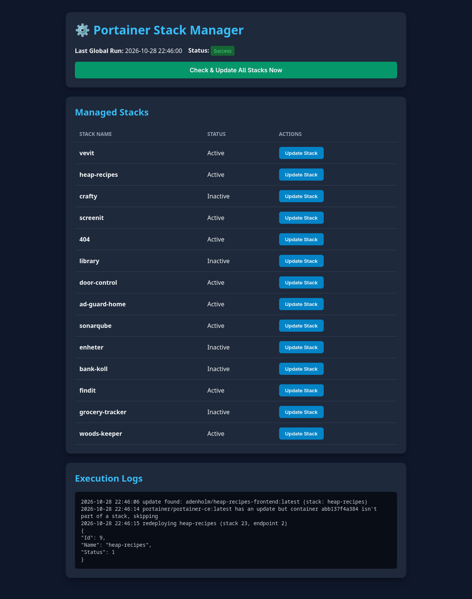

# Woods Keeper
[![Last Commit][last-commit-shield]][last-commit-url]
[![Build Status][build-shield]][build-url]
[![Repo Size][repo-size-shield]][repo-size-url]
[![Author][author-shield]][author-url]
<!-- [![Test Coverage][coverage-shield]][coverage-url] -->

**Woods Keeper** is a lightweight, containerized management application designed to automate, monitor, and trigger updates for Docker stacks managed via **Portainer**. 

Built with **Python (Flask)**, **Shell scripting**, and **Docker**, it provides a sleek web interface for tracking stack statuses and manually initiating individual or global stack redeployments.




---

## 📸 Features

* **Portainer Integration**: Direct integration via Portainer's REST API using API Keys.
* **Stack Discovery**: Dynamically fetches and lists all active stacks hosted on your target endpoint.
* **Granular Redeployments**:
  * Trigger updates across all managed stacks globally.
  * Trigger manual redeployments for individual stacks directly from the Web UI.
* **Standalone Safety**: Intelligently skips standalone containers not associated with a Docker Compose stack to prevent unexpected breakages.
* **Live Status & Logs**: Displays real-time operation logs and execution statuses inside the browser.
* **Multi-Arch Support**: Docker images built for `linux/amd64` and `linux/arm64` (ideal for Raspberry Pi setups).

---

## 🏗️ Architecture Overview

```
               ┌────────────────────────────────────────┐
               │          Woods Keeper App              │
               │  ┌──────────────┐    ┌──────────────┐  │
               │  │   Flask UI   │    │ auto-update  │  │
               │  │   (app.py)   │────│   (.sh)      │  │
               │  └──────┬───────┘    └──────┬───────┘  │
               └─────────┼───────────────────┼──────────┘
                         │ API Requests      │ Docker Engine API
                         ▼                   ▼
                 ┌──────────────┐    ┌──────────────┐
                 │  Portainer   │    │  Docker Host │
                 │     API      │    │    Socket    │
                 └──────────────┘    └──────────────┘
```

---

## 🚀 Quick Start & Deployment

### Prerequisites
* Docker & Docker Compose installed.
* Portainer instance running.
* Portainer API Key generated:
  1. In Portainer, go to **User Settings** (bottom-left avatar) -> **My Account**.
  2. Scroll down to **Access tokens** -> **Add access token**.
  3. Save the generated key (`ptr_...`).

### Deploying via Docker Compose / Portainer Stack

Add the following configuration to your Portainer stacks or run via Docker Compose:

```yaml
version: '3.8'

services:
  woods-keeper:
    image: ghcr.io/your-username/woods-keeper:latest
    container_name: woods-keeper
    restart: unless-stopped
    ports:
      - "5000:5000"
    environment:
      - PORTAINER_URL=http://<YOUR_PI_OR_SERVER_LAN_IP>:9000
      - API_KEY=ptr_your_access_token_here
    volumes:
      - /var/run/docker.sock:/var/run/docker.sock:ro
      - woods_keeper_data:/app/data

volumes:
  woods_keeper_data:
```

> **⚠️ Important Note on `PORTAINER_URL`:**  
> Do **not** use `http://localhost:9000` or `127.0.0.1`. Inside Docker containers, `localhost` resolves to the container itself. Use your host machine's actual LAN IP address (e.g., `http://192.168.1.100:9000`).

---

## ⚙️ Environment Variables

| Variable | Required | Default | Description |
| :--- | :---: | :---: | :--- |
| `PORTAINER_URL` | **Yes** | `http://localhost:9000` | Full URL (including port) of your Portainer instance accessible from inside the container. |
| `API_KEY` | **Yes** | *None* | Portainer Access Token (`ptr_...`) used for API authentication. |

---

## 📁 File Structure

```
.
├── app.py              # Flask server handling UI, routes, and API calls
├── auto-update.sh      # Core shell script inspecting containers & querying Docker/Portainer
├── Dockerfile          # Multi-arch Docker container definition
├── data/               # Persistent data folder (holds status.json)
└── README.md           # Documentation
```

---

## 🔌 API Endpoints

### 1. `GET /`
Renders the primary web dashboard.

### 2. `GET /api/data`
Returns JSON formatted status data, current execution logs, and an array of all active Portainer stacks.

**Response Example:**
```json
{
  "is_running": false,
  "last_run": "2026-10-28 21:58:33",
  "status": "Success",
  "logs": [
    "2026-10-28 21:58:40 update found: my-app:latest (stack: my-stack)",
    "2026-10-28 21:58:42 redeploying my-stack (stack 2, endpoint 1)"
  ],
  "stacks": [
    {
      "id": 1,
      "name": "portainer-stack",
      "endpoint_id": 1,
      "status": "Active"
    }
  ]
}
```

### 3. `POST /api/update`
Triggers an asynchronous update job.

**Request Body (Optional):**
```json
{
  "stack_id": 2
}
```
* If `stack_id` is provided, **only** that specific stack will be redeployed.
* If no body or an empty object `{}` is sent, a global update scan will run across all stacks.

---

## 🔨 Local Development & Building

To build the image locally on your machine or Raspberry Pi:

```bash
# Clone the repository
git clone https://github.com/your-username/woods-keeper.git
cd woods-keeper

# Build the Docker image
docker build -t woods-keeper .

# Run locally
docker run -d \
  -p 5000:5000 \
  -e PORTAINER_URL="http://192.168.1.100:9000" \
  -e API_KEY="ptr_..." \
  -v /var/run/docker.sock:/var/run/docker.sock:ro \
  woods-keeper
```

# Author
<p align="center">
  
  <br />
  <strong><a href="https://github.com/erikpersson0884">Erik Persson</a></strong><br />
  Creator &amp; Maintainer
</p>


<!-- Repo info Shields -->
[last-commit-shield]: https://img.shields.io/github/last-commit/erikpersson0884/woods-keeper/main?style=for-the-badge&cacheSeconds=30
[last-commit-url]: https://github.com/erikpersson0884/woods-keeper/commits/main

[repo-size-shield]: https://img.shields.io/github/repo-size/erikpersson0884/woods-keeper?style=for-the-badge&cacheSeconds=60
[repo-size-url]: https://github.com/erikpersson0884/woods-keeper

[author-shield]: https://img.shields.io/badge/Author-Erik%20Persson-blue?style=for-the-badge
[author-url]: https://github.com/erikpersson0884

[build-shield]: https://img.shields.io/github/actions/workflow/status/erikpersson0884/woods-keeper/docker-build.yml?branch=main&style=for-the-badge
[build-url]: https://github.com/erikpersson0884/woods-keeper/actions


<!-- Frameworks & Languages Shields -->
[vite-shield]: https://img.shields.io/badge/Vite-646CFF?logo=Vite&logoColor=white&style=for-the-badge
[react-shield]: https://img.shields.io/badge/React-61DAFB?logo=react&logoColor=white&style=for-the-badge
[vitest-shield]: https://img.shields.io/badge/Vitest-3E7CFF?logo=vitest&logoColor=white&style=for-the-badge
[docker-shield]: https://img.shields.io/badge/Docker-2496ED?logo=docker&logoColor=white&style=for-the-badge
[typescript-shield]: https://img.shields.io/badge/TypeScript-3178C6?logo=typescript&logoColor=white&style=for-the-badge


<!-- Test Coverage Shields -->
[coverage-shield]: https://img.shields.io/endpoint?url=https://raw.githubusercontent.com/erikpersson0884/woods-keeper/coverage/.github/coverage.json&style=for-the-badge&v=2
[coverage-url]: https://github.com/erikpersson0884/woods-keeper/actions