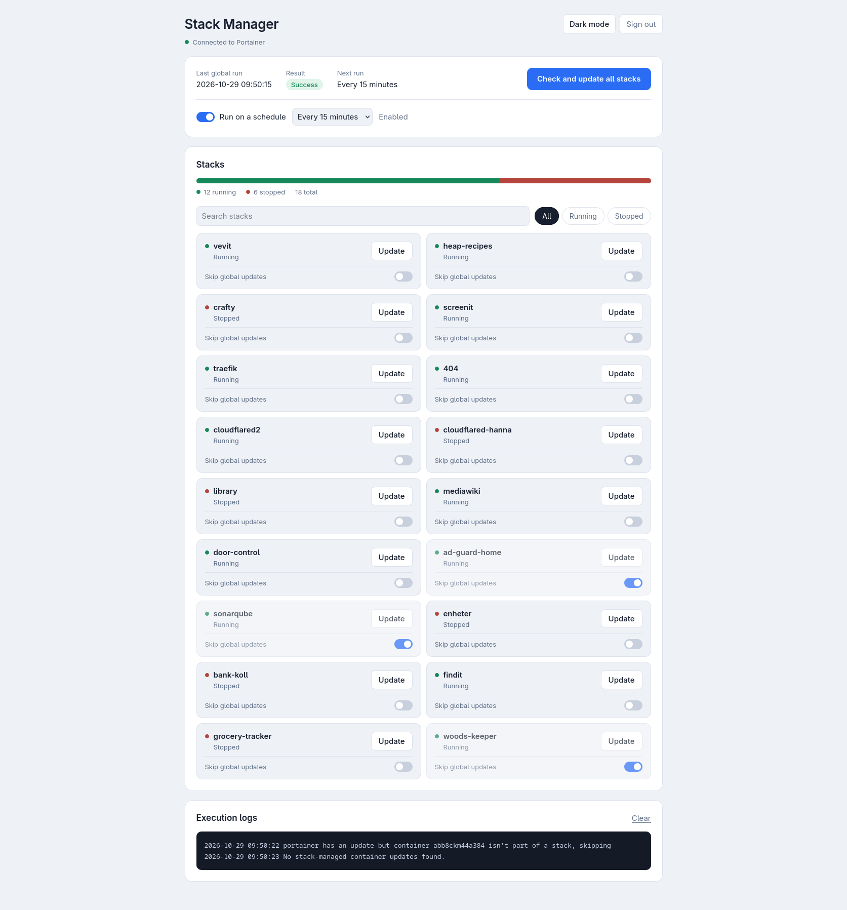
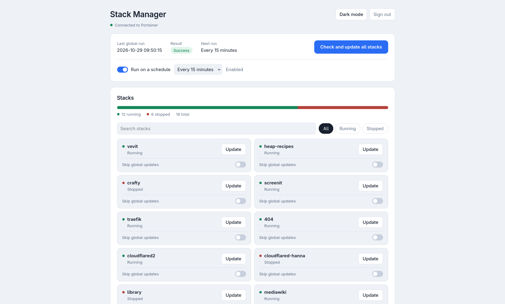
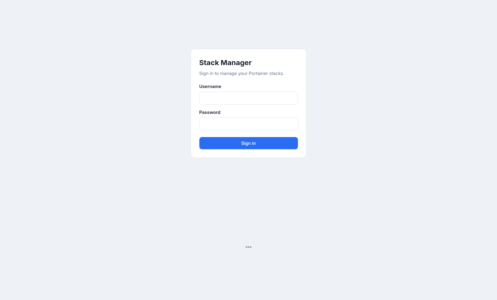
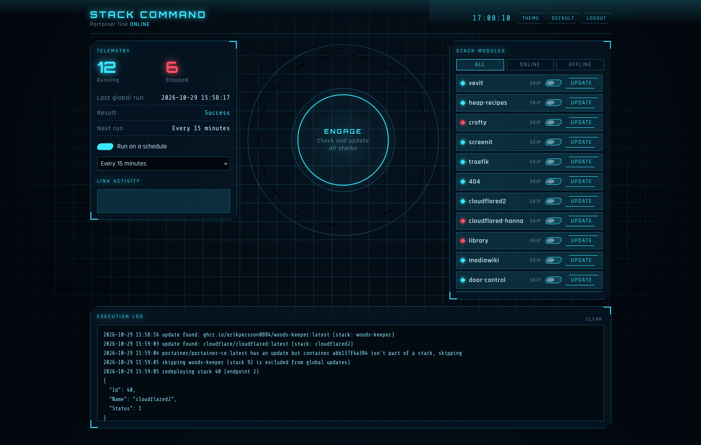

# Woods Keeper
[![Last Commit][last-commit-shield]][last-commit-url]
[![Build Status][build-shield]][build-url]
[![Repo Size][repo-size-shield]][repo-size-url]
[![Author][author-shield]][author-url]
<!-- [![Test Coverage][coverage-shield]][coverage-url] -->

**Woods Keeper** is a lightweight, containerized management application designed to automate, monitor, and trigger updates for Docker stacks managed via **Portainer**. 

Built with **Python (Flask)**, **Shell scripting**, and **Docker**, it provides a sleek web interface for tracking stack statuses and manually initiating individual or global stack redeployments.




---

## 📸 Features

* **Portainer Integration**: Direct integration via Portainer's REST API using API Keys.
* **Stack Discovery**: Dynamically fetches and lists all active stacks hosted on your target endpoint.
* **Granular Redeployments**:
  * Trigger updates across all managed stacks globally.
  * Trigger manual redeployments for individual stacks directly from the Web UI.
* **Scheduled Updates**: Enable recurring global update checks from the dashboard header.
* **Per-Stack Global Update Control**: Exclude selected stacks from global and scheduled updates while retaining manual updates with confirmation.
* **Standalone Safety**: Intelligently skips standalone containers not associated with a Docker Compose stack to prevent unexpected breakages.
* **Live Status & Logs**: Displays real-time operation logs and execution statuses inside the browser.
* **Raspberry Pi Support**: Docker images are built for `linux/arm64` (aarch64 Raspberry Pi OS).

---

## 🖼️ Screenshots

| Dashboard | Items |
|---|---|
|  |  |
| Alternative Dashboard style | |
|  | |


## 🏗️ Architecture Overview

```
               ┌────────────────────────────────────────┐
               │          Woods Keeper App              │
               │  ┌──────────────┐    ┌──────────────┐  │
               │  │   Flask UI   │    │ auto-update  │  │
               │  │   (app.py)   │────│   (.sh)      │  │
               │  └──────┬───────┘    └──────┬───────┘  │
               └─────────┼───────────────────┼──────────┘
                         │ API Requests      │ Docker Engine API
                         ▼                   ▼
                 ┌──────────────┐    ┌──────────────┐
                 │  Portainer   │    │  Docker Host │
                 │     API      │    │    Socket    │
                 └──────────────┘    └──────────────┘
```

---

## 🚀 Quick Start & Deployment

### Prerequisites
* Docker & Docker Compose installed.
* Portainer instance running.
* Portainer API Key generated:
  1. In Portainer, go to **User Settings** (bottom-left avatar) -> **My Account**.
  2. Scroll down to **Access tokens** -> **Add access token**.
  3. Save the generated key (`ptr_...`).

### Deploying via Docker Compose / Portainer Stack

Add the following configuration to your Portainer stacks or run via Docker Compose:

```yaml
version: '3.8'

services:
  woods-keeper:
    image: ghcr.io/your-username/woods-keeper:latest
    container_name: woods-keeper
    restart: unless-stopped
    ports:
      - "5000:5000"
    environment:
      - PORTAINER_URL=https://<YOUR_PORTAINER_HOST>:9443
      - API_KEY=${API_KEY}
      - ADMIN_USERNAME=${ADMIN_USERNAME}
      - ADMIN_PASSWORD=${ADMIN_PASSWORD}
    volumes:
      - /var/run/docker.sock:/var/run/docker.sock
      - woods_keeper_data:/app/data

volumes:
  woods_keeper_data:
```

Copy `.env.example` to `.env` and replace the placeholder values before
starting the application. Do not commit `.env`; it may contain your Portainer
API key and dashboard password.

> **⚠️ Important Note on `PORTAINER_URL`:**
> Use an HTTPS Portainer URL. Woods Keeper rejects plain HTTP so the API key cannot be sent unencrypted. Do **not** use `localhost` or `127.0.0.1` unless Portainer is reachable there with a trusted HTTPS certificate.

---

## ⚙️ Environment Variables

| Variable | Required | Default | Description |
| :--- | :---: | :---: | :--- |
| `PORTAINER_URL` | **Yes** | *None* | Full HTTPS URL (including port) of your Portainer instance accessible from inside the container. |
| `ALLOW_INSECURE_PORTAINER_HTTP` | No | `false` | Set to `true` only when Portainer is reached over a trusted private network using plain HTTP. |
| `API_KEY` | **Yes** | *None* | Portainer Access Token (`ptr_...`) used for API authentication. |
| `ADMIN_USERNAME` | **Yes** | *None* | Username required for HTTP Basic authentication on update requests. |
| `ADMIN_PASSWORD` | **Yes** | *None* | Strong password required for HTTP Basic authentication on update requests. |

`PORTAINER_URL` must use HTTPS by default. To connect to an internal Portainer
HTTP endpoint, explicitly set:

```env
PORTAINER_URL=http://portainer:9000
ALLOW_INSECURE_PORTAINER_HTTP=true
```

Never enable this setting when Portainer traffic can cross an untrusted network;
the API key would be sent without transport encryption.

## 🔎 SonarQube Analysis

The repository includes a GitHub Actions workflow at
`.github/workflows/sonarqube.yml`. It analyzes `app.py` and `auto-update.sh`
on pushes to `main`, pull requests, and manual workflow runs.

Configure these GitHub repository secrets before enabling the workflow:

| Secret | Description |
| :--- | :--- |
| `SONAR_HOST_URL` | Base URL of the SonarQube server, for example `https://sonarqube.example.com` |
| `SONAR_TOKEN` | SonarQube user or project analysis token |

The project key is configured in `sonar-project.properties` as
`woods-keeper`. Create a project with that exact key in SonarQube, or update
that file and the workflow together if you use a different key.

The dashboard header includes a schedule control for global update checks. Choose
15 minutes, 1 hour, 6 hours, or once a day. The setting is stored in the
persistent `data` volume and is disabled by default.

---

## 📁 File Structure

```
.
├── app.py              # Flask server handling UI, routes, and API calls
├── config.py           # Environment configuration and validation
├── storage.py          # Runtime status and schedule persistence
├── templates/          # Login and dashboard HTML templates
├── static/              # Dashboard CSS and JavaScript assets
├── auto-update.sh      # Core shell script inspecting containers & querying Docker/Portainer
├── Dockerfile          # Multi-arch Docker container definition
├── data/               # Persistent data folder (holds status.json)
└── README.md           # Documentation
```

---

## 🔌 API Endpoints

### 1. `GET /`
Renders the sign-in page for unauthenticated users and the primary web
dashboard after successful authentication.

### 2. `GET /api/data`
Returns JSON formatted status data, current execution logs, and an array of
all active Portainer stacks. Requires dashboard authentication.

**Response Example:**
```json
{
  "is_running": false,
  "last_run": "2026-10-28 21:58:33",
  "status": "Success",
  "logs": [
    "2026-10-28 21:58:40 update found: my-app:latest (stack: my-stack)",
    "2026-10-28 21:58:42 redeploying my-stack (stack 2, endpoint 1)"
  ],
  "stacks": [
    {
      "id": 1,
      "name": "portainer-stack",
      "endpoint_id": 1,
      "status": "Active"
    }
  ]
}
```

### 3. `POST /api/update`
Triggers an asynchronous update job.

This management endpoint requires HTTP Basic authentication using `ADMIN_USERNAME` and
`ADMIN_PASSWORD`. Expose the application only through HTTPS (or a private VPN); Basic
authentication must not be sent over plain HTTP.

**Request Body (Optional):**
```json
{
  "stack_id": 2
}
```
* If `stack_id` is provided, **only** that specific stack will be redeployed.
* If no body or an empty object `{}` is sent, a global update scan will run across all stacks.

### 4. `POST /api/schedule`
Updates the persistent global update schedule. This management endpoint requires
the same HTTP Basic authentication as `/api/update`.

```json
{
  "enabled": true,
  "interval": "6h"
}
```

Supported intervals are `15m`, `1h`, `6h`, and `daily`. Scheduled runs perform
the same global update scan as the **Check & Update All Stacks Now** button.

Browser requests that change data use a session CSRF token. API clients using
HTTP Basic authentication may continue to call the management endpoints
directly without a session CSRF token.

Each stack can be marked **Skip global updates** in the stack list. Excluded
stacks are skipped by global and scheduled scans. Updating an excluded stack
manually requires confirmation before Portainer pulls new images.

---

## 🔨 Local Development & Building

To build the image locally on your machine or Raspberry Pi:

```bash
# Clone the repository
git clone https://github.com/your-username/woods-keeper.git
cd woods-keeper

# Build the Docker image
docker build -t woods-keeper .

# Run locally
docker run -d \
  -p 5000:5000 \
  -e PORTAINER_URL="https://portainer.example.com:9443" \
  -e API_KEY="ptr_..." \
  -e ADMIN_USERNAME="admin" \
  -e ADMIN_PASSWORD="use-a-long-random-password" \
  -v /var/run/docker.sock:/var/run/docker.sock:ro \
  woods-keeper
```

# Author
<p align="center">
  
  <br />
  <strong><a href="https://github.com/erikpersson0884">Erik Persson</a></strong><br />
  Creator &amp; Maintainer
</p>


<!-- Repo info Shields -->
[last-commit-shield]: https://img.shields.io/github/last-commit/erikpersson0884/woods-keeper/main?style=for-the-badge&cacheSeconds=30
[last-commit-url]: https://github.com/erikpersson0884/woods-keeper/commits/main

[repo-size-shield]: https://img.shields.io/github/repo-size/erikpersson0884/woods-keeper?style=for-the-badge&cacheSeconds=60
[repo-size-url]: https://github.com/erikpersson0884/woods-keeper

[author-shield]: https://img.shields.io/badge/Author-Erik%20Persson-blue?style=for-the-badge
[author-url]: https://github.com/erikpersson0884

[build-shield]: https://img.shields.io/github/actions/workflow/status/erikpersson0884/woods-keeper/docker-build.yml?branch=main&style=for-the-badge
[build-url]: https://github.com/erikpersson0884/woods-keeper/actions


<!-- Frameworks & Languages Shields -->
[vite-shield]: https://img.shields.io/badge/Vite-646CFF?logo=Vite&logoColor=white&style=for-the-badge
[react-shield]: https://img.shields.io/badge/React-61DAFB?logo=react&logoColor=white&style=for-the-badge
[vitest-shield]: https://img.shields.io/badge/Vitest-3E7CFF?logo=vitest&logoColor=white&style=for-the-badge
[docker-shield]: https://img.shields.io/badge/Docker-2496ED?logo=docker&logoColor=white&style=for-the-badge
[typescript-shield]: https://img.shields.io/badge/TypeScript-3178C6?logo=typescript&logoColor=white&style=for-the-badge


<!-- Test Coverage Shields -->
[coverage-shield]: https://img.shields.io/endpoint?url=https://raw.githubusercontent.com/erikpersson0884/woods-keeper/coverage/.github/coverage.json&style=for-the-badge&v=2
[coverage-url]: https://github.com/erikpersson0884/woods-keeper/actions